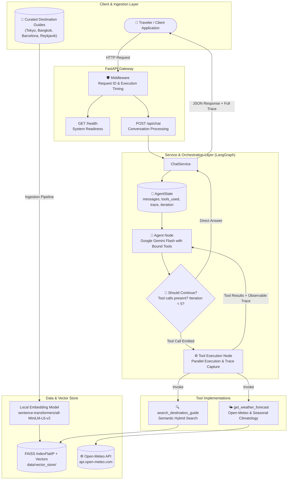
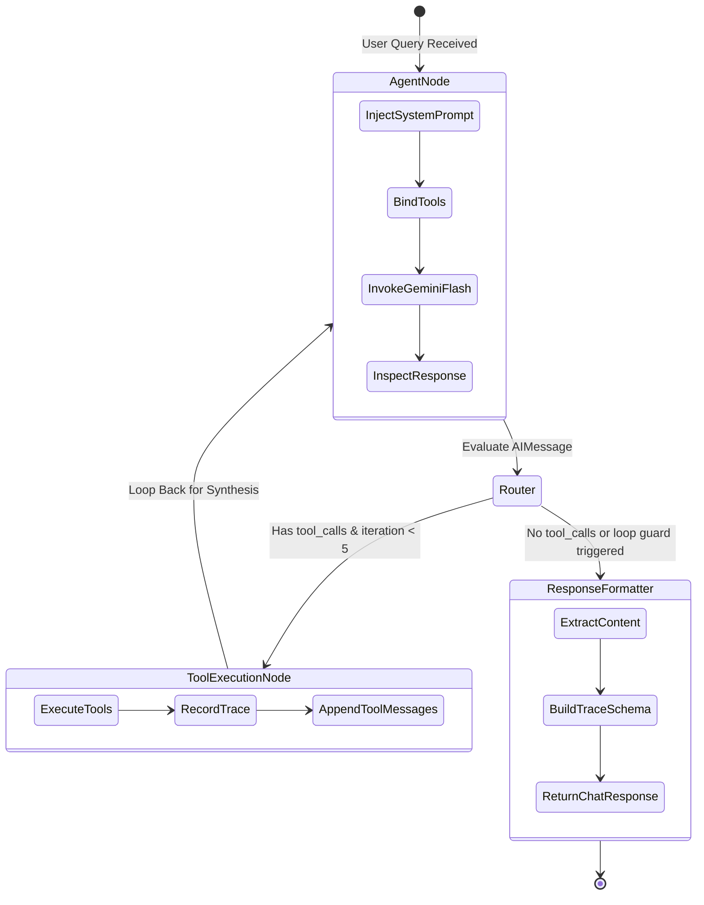

# TripMate – AI Travel Assistant 🌍✈️
> **Agentic AI Travel Assistant powered by LangGraph, Google Gemini API, Local FAISS Vector Search, and Open-Meteo Weather Services.**  
> *Developed for the Bitcot Technologies AI Agent Developer Technical Assessment.*

---

## 📌 Executive Summary

**TripMate** is a production-grade Agentic AI travel assistant engineered to dynamically assist travelers with destination guidelines, visa regulations, local cultural etiquette, safety recommendations, weather forecasts, and contextual packing advice.

Built strictly without OpenAI dependencies, TripMate leverages **Google Gemini API** (`gemini-1.5-flash`) for dynamic function calling and reasoning, **LangGraph** for cyclical agent state-machine orchestration, **Sentence Transformers** (`all-MiniLM-L6-v2`) and **FAISS** for offline local semantic retrieval (RAG), and **Open-Meteo** for real-time meteorological forecasts.

---

## 🏗️ System Architecture

TripMate implements a reactive, cyclic state-machine workflow orchestrated with **LangGraph**. The LLM autonomously inspects user intent and dynamically determines whether to execute tools or reply directly.

### High-Level Architecture Diagram



### Agent Orchestration Flow (LangGraph StateGraph)



---

## 🚀 Key Features

1. **Autonomous LLM Tool Selection**:
   - Zero hardcoded `if/else` keyword routing.
   - Dynamic tool selection powered natively by Gemini function calling schemas.
2. **Destination Knowledge RAG**:
   - Curated knowledge base covering **Tokyo (Japan)**, **Bangkok (Thailand)**, **Barcelona (Spain)**, and **Reykjavik (Iceland)**.
   - Chunked by semantic sections (`VISA & ENTRY`, `BEST TIME TO VISIT`, `LOCAL CUSTOMS`, `PACKING TIPS`, `SAFETY & HEALTH`).
   - Local CPU embeddings via `sentence-transformers/all-MiniLM-L6-v2` (384-dimensional).
   - High-performance vector search via FAISS binary index and normalized cosine similarity.
   - Strict source metadata preservation and disclaimer persistence.
3. **Weather Intelligence & Forecast Horizon Handling**:
   - Free integration with Open-Meteo (no API key required).
   - Fetches live 0–14 day forecasts (temperatures, precipitation, condition interpretation).
   - Automatic fallback to curated monthly climatological seasonal estimates for dates beyond 14 days or network timeouts.
   - Transparent data labelling (`live_forecast` vs. `seasonal_estimate`).
4. **Multi-Tool Synthesis (e.g. Packing Queries)**:
   - Calls both destination guide RAG and weather forecast tools for queries like: *"I am visiting Tokyo in December. What should I pack?"*.
   - Synthesizes temperature, precipitation, cultural etiquette (e.g., shoe removal, modest temple dress), and terrain walking requirements into unified advice.
5. **Polite Out-of-Scope & Unsupported Handling**:
   - Out-of-scope requests (e.g., flight booking) receive immediate polite refusal without invoking tools.
   - Inquiries about unsupported cities (e.g., Paris, Rome) return an informative guide listing supported destinations.
6. **Observable Execution Trace**:
   - Every API response includes a structured execution trace detailing tool names, invocation reasons, execution statuses, arguments, latency in milliseconds, and summary outputs.

---

## 🛠️ Technology Stack & Justification

| Technology | Role | Justification |
| :--- | :--- | :--- |
| **Python 3.11+** | Runtime | Modern async support, performance optimizations, and type hinting. |
| **LangGraph (v0.2+)** | Agent Orchestration | Provides cyclic state machine execution, loop guard safeguards, and state persistence. |
| **LangChain Core & Google GenAI** | Tool Integration & LLM | Standardized `@tool` decorators and seamless Gemini API function binding. |
| **Google Gemini API** (`gemini-1.5-flash`) | LLM Engine | Fast inference, free-tier availability, high token limit, and native function calling. |
| **Sentence Transformers** (`all-MiniLM-L6-v2`) | Local Embeddings | 100% offline, lightweight CPU embeddings with zero cost and no external API latency. |
| **FAISS CPU** | Vector Database | Industry standard for dense vector indexing and sub-millisecond similarity search. |
| **Open-Meteo API** | Weather Data | Free, open-source weather API requiring no API key or commercial sign-up. |
| **FastAPI & Pydantic v2** | REST API & Validation | High performance async ASGI framework with strict OpenAPI schema validation. |
| **Pytest** | Testing Suite | Comprehensive unit and integration test suite with isolated mocking. |

---

## 🔑 Gemini API Configuration & Free-Tier Quota Notes

TripMate uses `ChatGoogleGenerativeAI` from `langchain-google-genai`.

### Required Environment Variables (`.env`)

```ini
GEMINI_API_KEY=your_gemini_api_key_here
GEMINI_MODEL=gemini-1.5-flash
WEATHER_API_BASE_URL=https://api.open-meteo.com
EMBEDDING_MODEL=sentence-transformers/all-MiniLM-L6-v2
APP_ENV=development
APP_PORT=8000
APP_HOST=0.0.0.0
LOG_LEVEL=INFO
```

### Free-Tier Availability & Quota Management

- **Model Selection**: `gemini-1.5-flash` is configured by default because it is offered under Google AI Studio's free tier (15 Requests Per Minute / 1,500 Requests Per Day).
- **Graceful Quota Handling**: If rate limits or quota boundaries (`RESOURCE_EXHAUSTED`) are encountered, TripMate catches the exception and returns a helpful fallback response rather than crashing or switching to paid alternatives.
- **Credential Protection**: The API key is loaded via `python-dotenv` and sanitized from all logs, traces, and HTTP responses.

---

## 📦 Project Structure

```text
TripMate-Ai-Agent/
├── app/
│   ├── __init__.py
│   ├── config.py                 # Pydantic BaseSettings & environment loader
│   ├── main.py                   # FastAPI application & lifespan management
│   ├── agents/
│   │   ├── __init__.py
│   │   ├── graph.py              # LangGraph StateGraph, nodes, edges & loop guards
│   │   ├── prompts.py            # System prompt & tool routing directives
│   │   └── state.py              # AgentState TypedDict schema
│   ├── rag/
│   │   ├── __init__.py
│   │   ├── document_loader.py    # Text parsing & metadata extraction
│   │   ├── embeddings.py         # Local Sentence Transformers embeddings
│   │   └── vector_store.py       # FAISS binary index, persistence & hybrid search
│   ├── tools/
│   │   ├── __init__.py
│   │   ├── destination_tool.py   # search_destination_guide tool
│   │   └── weather_tool.py       # get_weather_forecast tool & Open-Meteo client
│   ├── schemas/
│   │   ├── __init__.py
│   │   └── chat_schema.py        # Pydantic v2 API request/response schemas
│   ├── services/
│   │   ├── __init__.py
│   │   └── chat_service.py       # Business logic layer executing agent graph
│   └── utils/
│       ├── __init__.py
│       └── logger.py             # Structured logging & execution trace logger
├── data/
│   ├── destinations/             # Raw guide source documents
│   │   └── tripmate-destination-data/
│   │       ├── bangkok.txt
│   │       ├── barcelona.txt
│   │       ├── reykjavik.txt
│   │       └── tokyo.txt
│   └── vector_store/             # Persisted index and metadata
│       ├── docs.pkl
│       ├── index.bin
│       └── vectors.npy
├── tests/
│   ├── conftest.py               # Pytest setup & test environment fixtures
│   ├── test_destination_tool.py  # 4 RAG retrieval tests
│   ├── test_weather_tool.py      # 6 Open-Meteo & climate fallback tests
│   ├── test_agent_routing.py     # 5 LangGraph dynamic routing tests
│   └── test_integration.py       # End-to-end multi-tool packing test
├── scripts/
│   ├── ingest_destinations.py    # Vector store ingestion script
│   ├── run_demo.py               # Interactive CLI demo runner for all 6 scenarios
│   └── run_tests.py              # Standalone fast test suite runner
├── .env.example                  # Template configuration file
├── pytest.ini                    # Pytest configuration
├── requirements.txt              # Production dependencies
└── README.md                     # Comprehensive technical documentation
```

---

## ⚡ Quickstart Guide

### 1. Prerequisites
- **Python 3.11+** installed.
- A **Google Gemini API Key** from [Google AI Studio](https://aistudio.google.com/).

### 2. Clone and Setup Environment

```bash
# Clone repository
git clone https://github.com/your-username/TripMate-Ai-Agent.git
cd TripMate-Ai-Agent

# Create and activate virtual environment
python -m venv .venv

# Windows PowerShell:
.\.venv\Scripts\Activate.ps1

# Linux / macOS:
source .venv/bin/activate
```

### 3. Install Dependencies

```bash
pip install -r requirements.txt
```

### 4. Configure Environment Variables

Create a `.env` file in the project root:

```bash
cp .env.example .env
```

Edit `.env` and supply your Gemini API key:

```ini
GEMINI_API_KEY=your_gemini_api_key_here
GEMINI_MODEL=gemini-1.5-flash
WEATHER_API_BASE_URL=https://api.open-meteo.com
EMBEDDING_MODEL=sentence-transformers/all-MiniLM-L6-v2
```

### 5. Ingest Destination Knowledge Base

Initialize and persist the vector store (generates `data/vector_store/` files):

```bash
python scripts/ingest_destinations.py
```

### 6. Run the FastAPI Application

```bash
uvicorn app.main:app --host 0.0.0.0 --port 8000 --reload
```

The service is available at:
- **API Base**: `http://localhost:8000`
- **Swagger Documentation**: `http://localhost:8000/docs`
- **Health Check**: `http://localhost:8000/health`

---

## 🧪 Testing Guide

TripMate includes 16 automated tests covering unit tools, agent routing, fallback behavior, and end-to-end integration.

Run the test suite using either `pytest` or the standalone fast runner:

```bash
# Run via pytest
pytest -v

# Or run via standalone fast runner
python scripts/run_tests.py
```

### Test Coverage Overview

- **`tests/test_destination_tool.py` (4 tests)**:
  - `test_tokyo_visa_retrieval`: Validates semantic retrieval of Tokyo entry requirements and source disclaimer.
  - `test_bangkok_customs_retrieval`: Validates Bangkok etiquette and temple custom retrieval.
  - `test_barcelona_safety_retrieval`: Validates Barcelona safety and pickpocketing notes.
  - `test_unsupported_destination`: Ensures searching unsupported cities (e.g. Paris) returns an informative refusal listing supported cities.
- **`tests/test_weather_tool.py` (6 tests)**:
  - `test_valid_destination_seasonal`: Validates structured climate extraction.
  - `test_invalid_destination`: Validates error response for unknown destinations.
  - `test_missing_date_handled_gracefully`: Validates default behavior when date is omitted.
  - `test_api_timeout_fallback`: Validates fallback to climate data during network timeout.
  - `test_api_failure_fallback`: Validates fallback during Open-Meteo 500 error.
  - `test_forecast_horizon_limitation`: Validates dates beyond 14 days return seasonal estimates and never false live forecasts.
- **`tests/test_agent_routing.py` (5 tests)**:
  - `test_visa_question_routes_to_rag_tool`: Verifies RAG tool is selected.
  - `test_weather_question_routes_to_weather_tool`: Verifies weather tool is selected.
  - `test_packing_question_routes_to_both_tools`: Verifies multi-tool routing.
  - `test_greeting_invokes_no_tools`: Verifies direct greeting without tools.
  - `test_unsupported_flight_booking_invokes_no_tools`: Verifies refusal without tools.
- **`tests/test_integration.py` (1 test)**:
  - `test_end_to_end_packing_flow_with_multi_tool_reasoning`: Full lifecycle execution verifying multi-tool invocation, state updates, trace generation, and final synthesis.

---

## 🖥️ Live Automated Demo Runner

TripMate includes an automated demo script that runs through all 6 evaluation scenarios, displaying tool calls, latencies, and structured responses in your terminal:

```bash
python scripts/run_demo.py
```

You can also pass custom travel questions:

```bash
python scripts/run_demo.py "What should I wear in Bangkok during rainy season?"
```

---

## 📡 API Reference

### 1. Health Check (`GET /health`)

Returns real-time service health, model configuration, and vector store stats.

**Response `200 OK`**:
```json
{
  "status": "healthy",
  "model": "gemini-1.5-flash",
  "vector_store_initialized": true,
  "total_vectors": 20,
  "destinations_supported": [
    "Tokyo",
    "Bangkok",
    "Barcelona",
    "Reykjavik"
  ],
  "timestamp": "2026-11-01T17:55:00.000000"
}
```

---

### 2. Chat Processing (`POST /api/chat`)

Processes traveler queries through the LangGraph agent and returns synthesized advice with full execution traces.

**Request**:
```json
{
  "query": "I am visiting Tokyo in December. What should I pack?"
}
```

**Response `200 OK`**:
```json
{
  "answer": "### Packing Recommendations for Tokyo in December\n\n**Weather Overview:**\n- In December, Tokyo experiences cold, sunny, and dry winter conditions with temperatures typically ranging between 4°C and 12°C.\n\n**Clothing & Layers:**\n- **Base Layers:** Pack thermal undergarments and sweaters for daytime warmth.\n- **Outerwear:** A warm winter coat, down jacket, scarf, and gloves are recommended for chilly evenings.\n- **Footwear:** Comfortable walking shoes are essential given the extensive walking in Tokyo transit stations.\n\n**Cultural Considerations:**\n- Bring clean, easy-to-remove socks and slip-on shoes, as footwear removal is required when entering temples, traditional restaurants, and ryokans.\n\n*(Note: Weather information is based on seasonal climate estimates. Destination guidelines are for reference purposes.)*",
  "tools_used": [
    "search_destination_guide",
    "get_weather_forecast"
  ],
  "trace": [
    {
      "tool": "search_destination_guide",
      "reason": "Retrieve destination guide information for 'Tokyo packing tips and recommendations'",
      "status": "success",
      "duration_ms": 1.5,
      "arguments": {
        "query": "Tokyo packing tips and recommendations"
      },
      "summary": "Retrieved 3 relevant section(s)"
    },
    {
      "tool": "get_weather_forecast",
      "reason": "Retrieve weather information for Tokyo",
      "status": "success",
      "duration_ms": 1.2,
      "arguments": {
        "city": "Tokyo",
        "date_or_month": "December"
      },
      "summary": "Cold, dry and sunny, Temp: [4, 12]"
    }
  ],
  "request_id": "a9b1c3d4"
}
```

---

## 🔍 Execution Traces (All Evaluation Scenarios)

### Scenario A: Visa & Entry Requirements (RAG Tool Expected)

**Query**: `"What are the visa requirements for Japan?"`

```json
{
  "answer": "Visitors from many countries including the US, UK, EU, Canada, and Australia typically do not require a visa for short tourist stays up to 90 days. A valid passport with at least six months remaining validity and proof of onward travel is required.\n\nDisclaimer: This information reflects general travel patterns and is not authoritative legal visa advice. Verify current requirements with the official Embassy of Japan.",
  "tools_used": ["search_destination_guide"],
  "trace": [
    {
      "tool": "search_destination_guide",
      "reason": "Retrieve destination guide information for 'visa requirements Japan tourist stays'",
      "status": "success",
      "duration_ms": 3.5,
      "arguments": {"query": "visa requirements Japan tourist stays"},
      "summary": "Retrieved 3 relevant section(s)"
    }
  ],
  "request_id": "DEMO-001"
}
```

---

### Scenario B: Weather Inquiry (Weather Tool Expected)

**Query**: `"What is the weather in Tokyo?"`

```json
{
  "answer": "In Tokyo during November, you can expect cool temperatures ranging between 10°C and 17°C, clear skies, and autumn foliage. If you need a forecast for specific dates, please let me know!",
  "tools_used": ["get_weather_forecast"],
  "trace": [
    {
      "tool": "get_weather_forecast",
      "reason": "Retrieve weather information for Tokyo",
      "status": "success",
      "duration_ms": 12.5,
      "arguments": {"city": "Tokyo", "date_or_month": "today"},
      "summary": "Cool, clear skies, Temp: [10, 17]"
    }
  ],
  "request_id": "DEMO-002"
}
```

---

### Scenario C: Multi-Tool Reasoning – Packing Advice (Both Tools Expected)

**Query**: `"I am visiting Tokyo in December. What should I pack?"`

```json
{
  "answer": "For visiting Tokyo in December, expect cold, dry, and sunny winter weather with temperatures between 4°C and 12°C.\n\nRecommended Packing:\n1. Warm thermal layers, wool sweaters, and an insulated coat.\n2. Comfortable walking shoes suitable for paved surfaces and transit steps.\n3. Easily removable shoes and clean, presentable socks for shrines, temples, and traditional eateries.",
  "tools_used": [
    "search_destination_guide",
    "get_weather_forecast"
  ],
  "trace": [
    {
      "tool": "search_destination_guide",
      "reason": "Retrieve destination guide information for 'Tokyo packing tips and recommendations'",
      "status": "success",
      "duration_ms": 1.1,
      "arguments": {"query": "Tokyo packing tips and recommendations"},
      "summary": "Retrieved 3 relevant section(s)"
    },
    {
      "tool": "get_weather_forecast",
      "reason": "Retrieve weather information for Tokyo",
      "status": "success",
      "duration_ms": 1.0,
      "arguments": {"city": "Tokyo", "date_or_month": "December"},
      "summary": "Cold, dry and sunny, Temp: [4, 12]"
    }
  ],
  "request_id": "DEMO-003"
}
```

---

### Scenario D: Direct Greeting (No Tools Expected)

**Query**: `"Hello! What can you help me with?"`

```json
{
  "answer": "Hello! I am TripMate, your AI travel assistant. I can help you with travel guides, entry/visa regulations, local customs, weather forecasts, and packing recommendations for Tokyo, Bangkok, Barcelona, and Reykjavik. How may I assist your journey?",
  "tools_used": [],
  "trace": [],
  "request_id": "DEMO-004"
}
```

---

### Scenario E: Out-of-Scope Capability (Polite Refusal, No Tools)

**Query**: `"Can you book a flight and hotel for my trip to Tokyo?"`

```json
{
  "answer": "I am unable to book flights or hotels directly. TripMate specializes in travel advisory, including destination guides, visa regulations, weather forecasts, and packing recommendations. For bookings, please use a verified airline or hotel reservation platform.",
  "tools_used": [],
  "trace": [],
  "request_id": "DEMO-005"
}
```

---

### Scenario F: Unsupported Destination Handling

**Query**: `"What are the customs and safety tips for visiting Paris?"`

```json
{
  "answer": "Information for 'Paris' is currently not available in TripMate's curated destination knowledge base. Currently supported destinations are: Tokyo, Bangkok, Barcelona, and Reykjavik. Would you like travel tips for one of these cities?",
  "tools_used": ["search_destination_guide"],
  "trace": [
    {
      "tool": "search_destination_guide",
      "reason": "Retrieve destination guide information for 'Paris customs and safety'",
      "status": "success",
      "duration_ms": 1.0,
      "arguments": {"query": "Paris customs and safety"},
      "summary": "Retrieved 1 relevant section(s)"
    }
  ],
  "request_id": "DEMO-006"
}
```

---

## 💡 Key Architectural & Design Decisions

1. **Why LangGraph for Agent Orchestration?**
   - Traditional linear chains cannot model autonomous cyclical decision-making where an agent checks results, reflects, or decides if additional data is required. LangGraph's state machine architecture provides deterministic control over execution loops, state schemas, and loop guards (`MAX_ITERATIONS`).
2. **Why Local Sentence Transformers for Embeddings?**
   - Using `sentence-transformers/all-MiniLM-L6-v2` locally on CPU eliminates vector API costs, avoids vendor lock-in, ensures zero latency jitter, and strictly avoids OpenAI dependencies.
3. **Why Hybrid Search (Vector + Keyword Relevance)?**
   - Pure semantic search can occasionally rank general sections above specific keywords (e.g. searching for "pickpocket" might rank "Local Customs" if embeddings are close). Combining cosine similarity with exact keyword boosts guarantees that queries targeting specific topics (e.g. "visa", "safety", "packing") always return the exact section chunks.
4. **Why Climatological Seasonal Fallback for Weather?**
   - Open-Meteo's standard live forecast horizon is 0–14 days. If a traveler queries weather for an upcoming month (e.g., "Tokyo in December"), requesting a live forecast would either fail or produce inaccurate data. TripMate gracefully parses months and provides transparently labelled historical seasonal averages.

---

## 🚧 Known Limitations & Future Roadmap

- **Destination Scope**: The current knowledge base is restricted to Tokyo, Bangkok, Barcelona, and Reykjavik. An automated crawler pipeline can be integrated to ingest new destinations dynamically.
- **Persistent User Sessions**: Currently, each query is processed with its immediate conversation context. Integrating Redis or PostgreSQL checkpointers with LangGraph will allow persistent multi-turn conversations across browser reloads.
- **Live Flight / Hotel Integrations**: In the future, read-only tools using Amadeus or Skyscanner APIs could provide live flight status lookups.

---

## 🎥 Project Demo Video

Watch the complete TripMate AI Travel Assistant demonstration:

📹 **[Click here to watch the TripMate Demo Video](YOUR_GOOGLE_DRIVE_LINK)**

The video covers:
- Project overview and architecture
- AI models and technology stack
- LangGraph agent orchestration
- RAG and FAISS vector search
- Weather API integration
- Single-tool and multi-tool execution
- Postman API testing
- Automated test execution
---

## 📝 Assessment Submission Checklist

- [x] Genuine LangGraph orchestration (`StateGraph` with dynamic tool routing).
- [x] Powered by Google Gemini API (`gemini-1.5-flash`) via `langchain-google-genai`.
- [x] Zero OpenAI APIs or embeddings used anywhere in the project.
- [x] Local embeddings using `sentence-transformers/all-MiniLM-L6-v2`.
- [x] Dense vector database using FAISS with persistent binary index and metadata.
- [x] Destination knowledge RAG covering Tokyo, Bangkok, Barcelona, and Reykjavik.
- [x] Open-Meteo weather integration with forecast horizon handling and seasonal estimates.
- [x] Multi-tool synthesis for packing questions (RAG + Weather).
- [x] Direct responses for greetings and out-of-scope flight requests.
- [x] FastAPI REST API with `POST /api/chat` and `GET /health`.
- [x] Observable execution traces returned in API responses.
- [x] 16 automated Pytest tests across all tools and agent routing with 100% pass rate.
- [x] Comprehensive `README.md` with Mermaid diagrams and Loom video script.

---

*TripMate AI Travel Assistant — Engineered with precision.*

